# BehaviorTree.ROS2 Architecture

## Table of Contents <!-- omit in toc -->

- [Introduction](#introduction)
- [The Big Picture](#the-big-picture)
- [The Packages](#the-packages)
- [The Fork](#the-fork)
  - [What It Changes](#what-it-changes)
  - [Where It Sits](#where-it-sits)
- [TreeExecutionServer](#treeexecutionserver)
  - [Threads](#threads)
  - [Registration](#registration)
  - [The Tick Loop and Its Ends](#the-tick-loop-and-its-ends)
  - [No Preemption](#no-preemption)
  - [The Hooks](#the-hooks)
- [The Node Wrappers](#the-node-wrappers)
  - [RosActionNode](#rosactionnode)
  - [RosServiceNode](#rosservicenode)
  - [The Topic Nodes](#the-topic-nodes)
- [One Goal](#one-goal)
- [Tests](#tests)
- [How to Extend the Fork](#how-to-extend-the-fork)
- [Who Uses It](#who-uses-it)
- [Design Decisions and Trade-offs](#design-decisions-and-trade-offs)

## Introduction

This document explains how BehaviorTree.ROS2 is built, what this fork changes, and what a user of it must know before deriving a server or a node from it. It assumes we have read the [README](../README.md) and know [BehaviorTree.CPP](https://www.behaviortree.dev/): a tree of nodes, ticked until it returns `SUCCESS` or `FAILURE`, and halted when it is interrupted. It does not repeat upstream's own documents, [tree_execution_server.md](../behaviortree_ros2/tree_execution_server.md) and [ros_behavior_wrappers.md](../behaviortree_ros2/ros_behavior_wrappers.md); it says what they leave out.

The repository is a fork of [BehaviorTree/BehaviorTree.ROS2](https://github.com/BehaviorTree/BehaviorTree.ROS2) with one commit of its own, described in [The Fork](#the-fork). Everything else is upstream's code, about 2,500 lines of C++ in `behaviortree_ros2`.

The library follows one idea: **the thread that ticks the tree does all the ROS work of its nodes**. A node never waits for an answer: it sends a goal or a request, returns `RUNNING`, and looks for the answer at its next tick. Each action client, service client and subscription lives in a callback group that no ROS executor spins, with a small executor of its own that only the node's `tick()` spins. A callback of a node therefore never runs while the tree is ticked elsewhere, and the nodes need no locks. The price is in [The Node Wrappers](#the-node-wrappers): nothing arrives between two ticks, and the two places that do wait, the creation of a client and a halt, hold the whole tree.

## The Big Picture

A client sends the name of a tree to `TreeExecutionServer`, which creates the tree from a `BT::BehaviorTreeFactory` filled from plugins and XML files, ticks it on a thread of its own, and returns its status. The nodes of the tree that talk to ROS derive from the four wrappers.

<!-- The source is diagrams/big-picture.mmd: change it, then run bin/render-diagrams.sh. -->
<p align="center"></p>

The interface of a `TreeExecutionServer`, on the node it is given or creates, `bt_action_server`:

| Name | Type | What it does |
|---|---|---|
| `bt_execution`, or the parameter `action_name` | `btcpp_ros2_interfaces/action/ExecuteTree` action | Run the tree `target_tree`. `payload` is a string the library only stores (`goalPayload()`); the result is a `NodeStatus` and a `return_message`; the feedback is a string. |
| `get_loaded_trees` | `btcpp_ros2_interfaces/srv/GetTrees` service | The names of the registered trees. The name is relative to the node's namespace, not to the node. |
| port `1667`, or `groot2_port` | `BT::Groot2Publisher` | The running tree, for Groot2. Created again for every goal. |
| `plugins`, `behavior_trees` | parameters, lists of `package/subfolder` | The folders of the `.so` plugins and of the `.xml` trees, looked up in the package's share folder. |
| `tick_frequency`, `ros_plugins_timeout` | parameters | 100 Hz and 1000 ms by default. The second becomes both timeouts of `BT::RosNodeParams` for every node of a plugin. |

`action_name`, `tick_frequency` and `groot2_port` are read-only. The parameters are declared by `generate_parameter_library` from [`bt_executor_parameters.yaml`](../behaviortree_ros2/src/bt_executor_parameters.yaml) and described in [bt_executor_parameters.md](../behaviortree_ros2/bt_executor_parameters.md).

## The Packages

| Package | Role | Depends on |
|---|---|---|
| `btcpp_ros2_interfaces` | The `ExecuteTree` action, the `GetTrees` service and the `NodeStatus` message; `Sleep.action` is for the samples. No code. | ROS alone |
| `behaviortree_ros2` | `TreeExecutionServer`, compiled into a library, static by default, and the four node wrappers, `plugins.hpp` and `RosNodeParams`, which are headers only. | `btcpp_ros2_interfaces`, `behaviortree_cpp`, `rclcpp_action`, `generate_parameter_library`, Boost.Signals2 |
| `btcpp_ros2_samples` | A sample server, `sample_bt_executor`, and sample nodes with their servers. | `behaviortree_ros2` |

The dependencies go one way: the samples on the library, the library on the interfaces. A program that only sends goals needs `btcpp_ros2_interfaces` alone.

## The Fork

### What It Changes

One commit, `b0ae01d`, "Halt the tree and complete the execution when a node throws": 43 lines added and 3 removed, in [`tree_execution_server.cpp`](../behaviortree_ros2/src/tree_execution_server.cpp), a comment of its header and upstream's `tree_execution_server.md`.

`TreeExecutionServer::execute()` runs the tree inside one `try` block. Upstream's `catch` sets the message of the result, aborts the goal and returns. When a node throws while the tree is ticked, that leaves three things undone:

- **The tree is not halted.** A node that was `RUNNING` stays so: an action whose goal was sent goes on running on its server, with nobody to cancel it.
- **`onTreeExecutionCompleted()` is not called.** A server that reports the end of a run there, or cleans up, never learns that the run has ended.
- **The result has no status.** `node_status` keeps its default, `IDLE`.

The fork's `catch` block does what every other end of a run does:

1. It sets the status of the result to `FAILURE`.
2. If `onTreeCreated()` has returned (`tree_created`) and `onTreeExecutionCompleted()` has not been called yet for this goal (`execution_completed`), it halts the tree, inside a `try` of its own, so that a halt that throws too is logged and does not skip the next step.
3. It then calls `onTreeExecutionCompleted(FAILURE, false)`, whose message, if any, replaces `Behavior Tree exception:` followed by the text of the exception.
4. It aborts the goal, as before.

The two flags draw the limits. An exception thrown before `onTreeCreated()` returns, by `createTree()` for an unknown tree or by `onTreeCreated()` itself, is handled as upstream does, apart from the status: there is no tree of this goal to halt and no run to complete. An exception thrown by `onTreeExecutionCompleted()` itself, when it is called for a cancel or for a stop asked by `onLoopAfterTick()`, does not call it a second time. The same path serves an exception thrown by `onLoopAfterTick()` or `onLoopFeedback()`, which run in the same `try` block.

The fork also adds this document, with its diagrams in `docs/diagrams` and the two scripts of `bin` that render and check them. It also corrects upstream's documentation where it did not match the code: the Test badge and a sentence of the README, the sample log and the wording of `btcpp_ros2_samples/README.md`, a comment of `btcpp_ros2_samples/config/sample_bt_executor.yaml`, and a note on the key of a parameter file in `tree_execution_server.md`. None of it touches code.

### Where It Sits

| | Commit | What it is |
|---|---|---|
| Upstream's release | `72a3bf5` | Tag `0.3.0`, the version of the three `package.xml` files. |
| The fork point | `6c6aa07` | Two commits later: `760f23d`, formatting, and `6c6aa07`, which removes a `return` from the goal response callback of `RosActionNode` (upstream's pull request 122). On 15 November 2026 it is still the head of upstream's branch `humble`, its default branch. |
| The fork | `b0ae01d` | The head of the fork's `humble`, and of its branch `fix/complete-execution-on-exception`. The same commit is the head of upstream's pull request 135, which upstream closed without merging. |

The fork point is the parent of the only commit `git log` shows with the fork's author; the upstream refs were read with `git ls-remote`. Following upstream therefore costs nothing today, and one rebase of 43 lines when its `humble` moves.

## TreeExecutionServer

[`tree_execution_server.cpp`](../behaviortree_ros2/src/tree_execution_server.cpp), 357 lines, and [`bt_utils.cpp`](../behaviortree_ros2/src/bt_utils.cpp), which loads the plugins and the trees. The server is not a node: it holds one, created by its constructor or given to it, and whoever owns the server spins that node.

### Threads

| Thread | What runs there |
|---|---|
| The executor that spins the node | `handle_goal()`, which calls `onGoalReceived()`; `handle_cancel()`; `handle_accepted()`, which joins the thread of the previous goal and starts a new one; the first registration, from a wall timer of 1 ms that fires once; `get_loaded_trees`. |
| The goal thread, one `std::thread` per goal | `execute()`: a registration if the parameters changed, the creation of the tree, the tick loop, every other hook, and all the ROS callbacks of the tree's nodes. |
| Groot2's own threads | `BT::Groot2Publisher`, inside BehaviorTree.CPP. |

The server keeps one tree, one tree name and one payload: those of the last goal started. The global blackboard, `globalBlackboard()`, lives as long as the server; each tree gets a root blackboard that is its child. A subscription of a derived server writes to it from the executor thread while the tree reads it from the goal thread, which the blackboard allows.

The destructor does not join the goal thread. A `std::thread` that ran and was not joined ends the program when it is destroyed, so a server that has run a goal cannot be destroyed cleanly.

### Registration

`executeRegistration()` fills the factory:

1. It forgets every registered tree, `clearRegisteredBehaviorTrees()`. The node types stay.
2. It reads the parameters again.
3. It calls the hook `registerNodesIntoFactory()`. The header says "after the plugins", but the code calls it before them.
4. It loads every `.so` of the folders of `plugins`. A plugin exports `BT_RegisterNodesFromPlugin`, the symbol of BehaviorTree.CPP, or `BT_RegisterRosNodeFromPlugin`, of [`plugins.hpp`](../behaviortree_ros2/include/behaviortree_ros2/plugins.hpp), which also receives the `RosNodeParams`: the server's node and the timeouts.
5. It registers every `.xml` of the folders of `behavior_trees`.

A folder, a plugin or a file that fails is logged and skipped; the server starts all the same, and the goal for a missing tree is aborted when `createTree()` throws.

It runs at two moments. The first is the timer, once the node is spun, unless a derived class has already called it in its constructor. The second is easy to miss: **at the start of every goal, if the parameters are newer than the copy the server holds**, on the goal thread. That is what lets `plugins` and `behavior_trees` change while the server runs. It has two consequences:

- **Trees registered any other way are lost.** A derived server that registers trees itself, through `factory()`, must register them again after every registration, because step 1 forgets them.
- **A plugin is not loaded twice.** At a second registration its node types are still in the factory, BehaviorTree.CPP refuses an ID that is already registered, and the server logs `Failed to load ROS Plugin` for a plugin that works. A plugin that changed on disk needs a restart.

What counts as "newer" depends on the version of `generate_parameter_library`. Its listener stamps its parameters in the callback the node calls whenever a parameter is set or declared. The release in rosdistro for Jazzy on 15 November 2026, 0.7.7, stamps only when one of the server's own six parameters is in the set. Older releases, 0.7.6 included, stamp on every call: there, declaring or setting any parameter on the server's node, one of a derived class included, registers everything again before the next goal. Read the generated `bt_executor_parameters.hpp` of the build to know which one we have: the newer one has `any_param_updated` in `update()`.

### The Tick Loop and Its Ends

`execute()` creates the tree, calls `onTreeCreated()`, starts the Groot2 publisher, then loops while the status is `RUNNING`: it checks for a cancel, ticks the tree once (`tickExactlyOnce()`), calls `onLoopAfterTick()` and `onLoopFeedback()`, and sleeps until the next period with `Tree::sleep()`, which a node cuts short with `emitWakeUpSignal()`, as `RosActionNode` does when a result arrives.

| The run ends because | The tree | `onTreeExecutionCompleted` | The goal | `node_status` |
|---|---|---|---|---|
| the tree returns `SUCCESS` | has ended | `(SUCCESS, false)` | succeeded | `SUCCESS` |
| the tree returns `FAILURE` | has ended | `(FAILURE, false)` | aborted | `FAILURE` |
| the client cancels | halted | `(RUNNING, true)` | canceled | `RUNNING` |
| `onLoopAfterTick()` returns a status | halted | `(that status, true)` | aborted | that status |
| an exception after `onTreeCreated()`, in the fork | halted | `(FAILURE, false)` | aborted | `FAILURE` |
| an exception before, e.g. an unknown tree | none | not called | aborted | `FAILURE` in the fork, `IDLE` upstream |

`was_cancelled` is true for a cancel and for a stop asked by `onLoopAfterTick()` alike; `tree_execution_server.md` says otherwise. When ROS shuts down during a run, the loop ends with the status `RUNNING`: the hook is called with `(RUNNING, false)` but the tree is not halted, and aborting the goal then throws, since the goal no longer exists: the thread of the goal ends the process with `std::terminate` ([Review.md](Review.md)).

Only exceptions derived from `std::exception` are caught, and only inside the `try` block. `onTreeExecutionCompleted()` is called outside it at a normal end, and from the `catch` block in the fork: an exception it throws there leaves the goal thread and ends the program.

### No Preemption

The server accepts every goal `onGoalReceived()` does not refuse, even while a tree runs. `handle_accepted()` then joins the thread of the running goal before it starts the new one: the second goal is accepted and waits, and the executor thread that waits serves nothing else of the action server until the running tree ends by itself. The library neither queues goals explicitly nor replaces the running one.

A server that wants a new goal to replace the running one does it with the hooks: `onGoalReceived()`, on the executor thread, raises a flag, and `onLoopAfterTick()`, on the goal thread, returns a status when it sees it, which halts the tree and aborts its goal. The flag crosses two threads.

### The Hooks

| Hook | Thread | When | What it may do |
|---|---|---|---|
| `onGoalReceived(tree, payload)` | executor | a goal arrives | Return false to reject it. |
| `registerNodesIntoFactory(factory)` | executor, or goal | every registration | Register node types in code. Registering the same ID at a second registration throws. |
| `onTreeCreated(tree)` | goal | the tree exists, no tick yet | Attach loggers, fill the blackboard. An exception here aborts the goal without `onTreeExecutionCompleted()`. |
| `onLoopAfterTick(status)` | goal | after every tick | Return a status to halt the tree and abort the goal with it. |
| `onLoopFeedback()` | goal | after every tick | Return a string to publish as feedback. |
| `onTreeExecutionCompleted(status, was_cancelled)` | goal | every end of a run, see the table above | Return the `return_message` of the result. Must not throw. |

## The Node Wrappers

Templates in headers, one per kind of ROS entity. A derived node is registered with `factory.registerNodeType<T>(name, params)`, where `params` is a `BT::RosNodeParams`: the node the entities are created on, a default name, `server_timeout` and `wait_for_server_timeout`. The name of the action, service or topic comes from the port `action_name`, `service_name` or `topic_name`, else from the default; a port that points to the blackboard is read at the first tick.

The clients and the subscriptions are shared: a static registry per message type, keyed by the node's name and the entity's name, holds one instance, which every tree node of that type and name uses. The registry keeps weak pointers, so an instance dies with the last tree that uses it.

Creating a client waits for its server, up to `wait_for_server_timeout`, in the constructor of the tree node, that is inside `createTree()`: a tree with clients of servers that are down takes that long per client to be created, then logs an error and goes on.

### RosActionNode

[`bt_action_node.hpp`](../behaviortree_ros2/include/behaviortree_ros2/bt_action_node.hpp), 579 lines. The derived class gives the goal, `setGoal()`, and judges the result, `onResultReceived()`.

| State | At a tick | Next |
|---|---|---|
| `IDLE` | `setGoal()` false: `onFailure(INVALID_GOAL)`. Server not ready: `onFailure(SERVER_UNREACHABLE)`. Else the goal is sent. | `RUNNING` |
| `RUNNING`, goal not answered | Spins its executor. No answer after `server_timeout`: `onFailure(SEND_GOAL_TIMEOUT)`. Rejected: `onFailure(GOAL_REJECTED_BY_SERVER)`. | `RUNNING`, or what `onFailure()` returns |
| `RUNNING`, goal accepted | Spins its executor. `onFeedback()` returned another status than `RUNNING`: the goal is cancelled and the node returns it. A result has arrived: `onFailure(ACTION_ABORTED)`, `onFailure(ACTION_CANCELLED)` or `onResultReceived()`. | `RUNNING`, or the status returned |

There is no timeout on the result: a goal that never ends keeps the node `RUNNING` until something halts it.

**A halt cancels the goal, and waits for it.** `halt()` on a `RUNNING` node calls `cancelGoal()`, then `onHalt()`. `cancelGoal()` waits for the answer to the goal if it has not come, asks for the result and for the cancel, and waits for both, each up to `server_timeout`: up to three times `server_timeout` during which the thread that halts, the goal thread of the server, does nothing else.

**A halt can throw `UnknownGoalHandleError`.** `rclcpp_action` forgets a goal as soon as its result arrives, and `async_get_result()` and `async_cancel_goal()` throw `rclcpp_action::exceptions::UnknownGoalHandleError` for a goal it has forgotten. `cancelGoal()` calls both without a `try`, with the goal handle the node holds. The node keeps the handle of its previous goal when it starts again: only the first tick after the answer replaces it. So a node that runs a second time and is halted before its new goal is answered cancels the goal of its first run, and throws from `halt()`; the new goal is then never cancelled. [Review.md](Review.md) lists the other cases it measured. The exception leaves `halt()` and travels to whoever halts the tree. In `TreeExecutionServer` that is the tick loop, where the fork's `catch` block ends the run; a halt from somewhere that catches nothing ends the program. The fork does not change `cancelGoal()`: a derived node that can be halted at any moment overrides `halt()`, catches this exception and calls `onHalt()` itself, since there is nothing left to cancel.

### RosServiceNode

[`bt_service_node.hpp`](../behaviortree_ros2/include/behaviortree_ros2/bt_service_node.hpp). The derived class gives the request, `setRequest()`, and judges the response, `onResponseReceived()`.

| State | At a tick | Next |
|---|---|---|
| `IDLE` | `setRequest()` false: `onFailure(INVALID_REQUEST)`. Service not ready: `onFailure(SERVICE_UNREACHABLE)`. Else the request is sent. | `RUNNING` |
| `RUNNING` | Spins its executor. No response after `server_timeout`: `onFailure(SERVICE_TIMEOUT)`. A response: `onResponseReceived()`. | `RUNNING`, or the status returned |

A halt only resets the status. A service call cannot be cancelled: the server still carries it out, and the response is dropped.

### The Topic Nodes

`RosTopicSubNode` and `RosTopicPubNode` are condition nodes: they return `SUCCESS` or `FAILURE` at every tick, never `RUNNING`, and a halt does nothing.

- **`RosTopicSubNode`** spins its executor, then calls `onTick()` with the last message received since the previous tick, or with none. `latchLastMessage()` true keeps the message for the next ticks. The subscription has a queue of 1 and the default quality of service, so of several messages between two ticks only the last is seen, and a message a latched publisher sent before the subscription existed is not received. The instance is shared, and gives its last message to a tree node created later.
- **`RosTopicPubNode`** fills a message in `setMessage()` and publishes it, with a queue of 1. Each tree node has its own publisher, created directly on the server's node.

## One Goal

From the goal to the result, with the two ways a run ends by itself: the tree returns a status, or a node throws.

<!-- The source is diagrams/one-goal.mmd: change it, then run bin/render-diagrams.sh. -->
<p align="center"></p>

The last branch is the fork's: upstream goes from the exception straight to the aborted goal.

## Tests

The repository has no test: no test folder, and no `CMakeLists.txt` adds one. Upstream's workflow `test.yml` builds the three packages on ROS 2 Humble and runs `colcon test`, which finds nothing to run; `pre-commit.yaml` checks the formatting. Nothing runs `bin/check-diagrams.sh` but us, after changing a diagram.

What is tested is tested by the users, see [Who Uses It](#who-uses-it). The fork's change has one test there, `ATreeThatThrowsEndsItsRun` of StepIt Commander.

By hand, the samples run a server and a tree with an action node:

```
ros2 launch btcpp_ros2_samples sample_bt_executor.launch.xml
ros2 action send_goal /behavior_server btcpp_ros2_interfaces/action/ExecuteTree "{target_tree: SleepActionSample}"
```

Not tested anywhere we know of: a halt of an action node at the moment its goal ends, a registration during a call of `get_loaded_trees`, and the end of a program whose server has run a goal.

## How to Extend the Fork

| To... | Change... |
|---|---|
| fix the library | Commit on a branch from the fork's `humble`, open a pull request upstream, merge into the fork's `humble`. Add the commit to [What It Changes](#what-it-changes). Then move the commit each user pins. |
| follow upstream | Rebase the fork's `humble` on upstream's. The one conflict to expect is the `catch` block of `execute()`. Update [Where It Sits](#where-it-sits), build the users and run their tests. |
| drop the fork | Once upstream holds the fix, pin upstream's commit in the users and archive the fork. Upstream closed pull request 135 without merging, so this needs a new pull request there. |
| change a diagram | Edit `docs/diagrams/<name>.mmd`, run `bin/render-diagrams.sh`, which needs Node.js and Chrome, then `bin/check-diagrams.sh`; commit the `.mmd` and the `.svg`. |

Writing a node or a server is upstream's subject: see its two documents, and `btcpp_ros2_samples`.

## Who Uses It

- **[StepIt Commander](https://github.com/kineticsystem/stepit-commander)**, a generic server of objectives: its `CommanderServer` derives from `TreeExecutionServer`, overrides `onGoalReceived`, `onTreeCreated`, `onLoopAfterTick`, `onLoopFeedback` and `onTreeExecutionCompleted`, and builds preemption on them as [No Preemption](#no-preemption) describes. It reports the end of every run from `onTreeExecutionCompleted`, which is why the fork exists.
- **StepIt Macro**, a focus stacking rig: its behaviors derive from `RosServiceNode` and from a `RosActionNode` of its own, whose `halt()` drops `UnknownGoalHandleError`, and its gamepad program builds `btcpp_ros2_interfaces` alone, to send goals.

Both pin the fork at one commit in a `.repos` file and build `behaviortree_ros2` and `btcpp_ros2_interfaces` from source, in ROS 2 Jazzy. Neither builds `btcpp_ros2_samples`, and neither runs a test of this repository, since it has none.

## Design Decisions and Trade-offs

**A fork, pinned at a commit, not a Debian package and not upstream's branch.** There is no package to prefer: on 15 November 2026 `behaviortree_ros2` is in the rosdistro of no distribution, Humble, Jazzy, Kilted or Rolling, so no `ros-jazzy-behaviortree-ros2` exists and every user builds it from source anyway; only `behaviortree_cpp` is released. Building upstream's `humble` would lose the fix of [What It Changes](#what-it-changes), on which a server that reports the end of its runs depends. The price is a repository to keep, a pin to move by hand in every user, and the risk that two users pin different commits and are then built into one workspace.

**Every commit of the fork is a pull request upstream.** The fork holds what upstream has not merged yet, and nothing we would keep for ourselves, so it can be dropped the day upstream catches up. Upstream closed our one pull request unmerged, so the review questions whether this policy can hold. The price: a weakness of upstream that needs a larger change, e.g. the halt of `RosActionNode`, is worked around in the users, once per user, and stays in the library.

**ROS callbacks run inside the tick.** Upstream's choice: no locks in the nodes, and a node sees a consistent state during its tick. The price is that a node only hears ROS when it is ticked, and that the two waits, for a server at creation and for a cancel at a halt, stop the whole tree and the server's loop with it.

**One thread per goal, joined before the next.** Upstream's choice: one tree at a time, with no queue to manage. The price is in [No Preemption](#no-preemption): a second goal is accepted and then blocks an executor thread, and replacing the running goal is left to the derived server.

**Registration again when the parameters change.** Upstream's choice: `plugins` and `behavior_trees` can change without a restart. The price: it forgets the trees a derived server registered itself, it logs an error for every plugin already loaded, and with an older `generate_parameter_library` any parameter set on the node triggers it.

**No tests here.** Upstream has none, and the fork adds none: its one change is tested where it matters, in the server that needs it. The price is that a rebase on upstream is only checked by building the users and running their tests.
